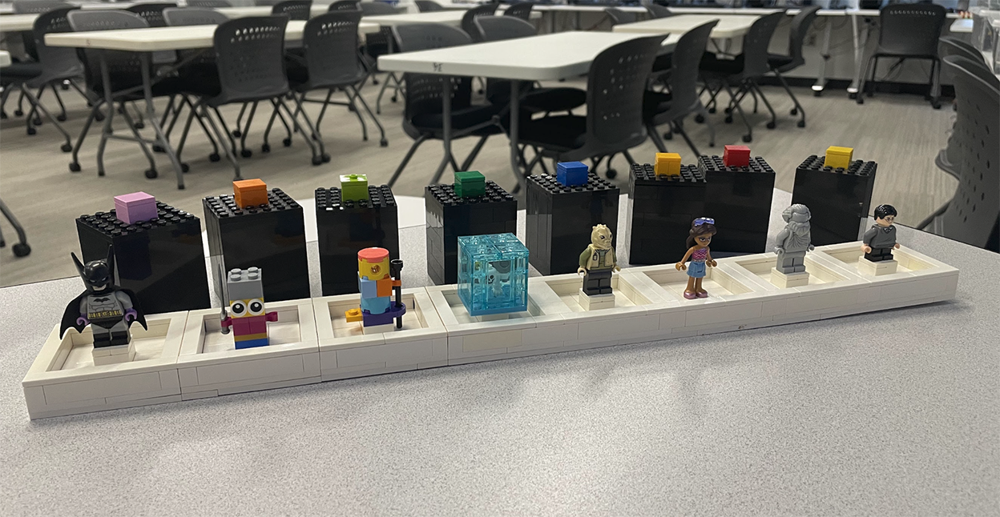

[Home](/) / Build a Solution Activity Instrucitons

## Build a Solution Activity Instructions

This activity is good for between four to eight groups of approximately four students.

 

### Preparation

You can use the [Prototyping Slide Deck](https://docs.google.com/presentation/d/1H387RyPTIVO1Q-NpD4R5JsnXWvsPtBGS_8s8nRDAWJ4/edit?usp=sharing) in class. Feel free to copy and customize as needed. 

You will need to provide your class with a question they are answering, for example:

> What factors play a role in determining a individual's likelihood to stay healthy?

Provide each group with a separate scenario, for example:

- Access to clean drinking water in rural and remote regions
- Growing urban traffic congestion in downtown core 
- Growing e-waste in poorer communities
- Detecting early-stage cancers for patients living in remote areas
- Managing the growing microplastics problem in our water
- Accessing fresh food in areas where food cannot be easily grown

Give the class approximately 60 minutes to build a solution and present their findings. The above question and scenario examples have resulted in the following solutions:

- Water treatment plant
- Downtown park space
- Community centre with food bank
- Mobile hospital 

### Schedule

This is a suggested class schedule based on the provided [Prototyping Slide Deck](https://docs.google.com/presentation/d/1H387RyPTIVO1Q-NpD4R5JsnXWvsPtBGS_8s8nRDAWJ4/edit?usp=sharing).

| Time | Description | 
| -- | -- |
| 5:00 | Welcome students into the classroom, give them a chance to look around. |
| 5:00 | Explain why we have a room full of LEGO bricks at Humber Polytechnic. There are slides highlighting the BrickMMO project. Please promote the BrickMMO events! |
| 10:00 | Use the cube puzzles as a warm-up. Each group gets nine blocks. Keep track of the winning group, they can pick their LEGO theme first. There are slides with hints if you find students are struggling. |
| 5:00 | Present the question and scenarios. Describe the challenge. |
| 5:00 | One by one let groups come to the front and reveal a minifig, give that group the matching bin of LEGO and a baseplate. |
| 60:00 | Let groups build solutions to their scenarios. |
| 30:00 | Each group presents their findings. You can use the little circular table at the front of the class to showcase the build. |
| 10:00 | Close the session. Awards prizes if you have them. |

When piking themes, here are the minifigures:

--resources--

---  

